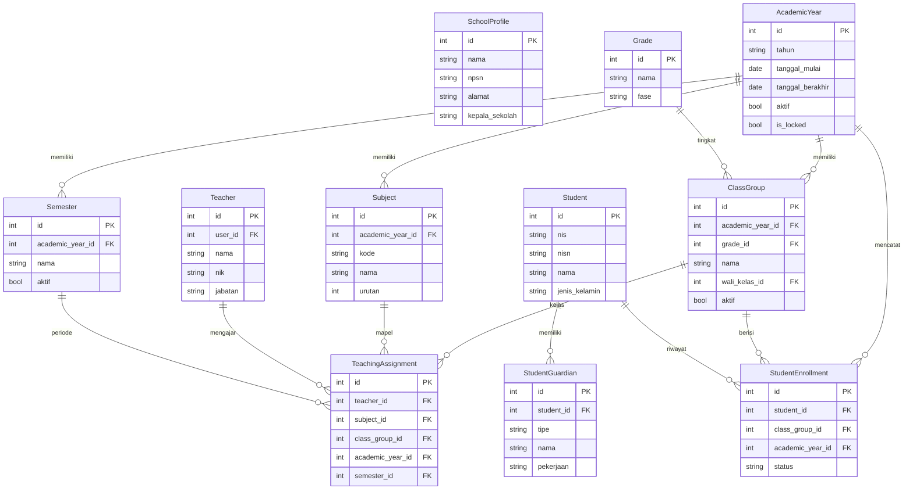
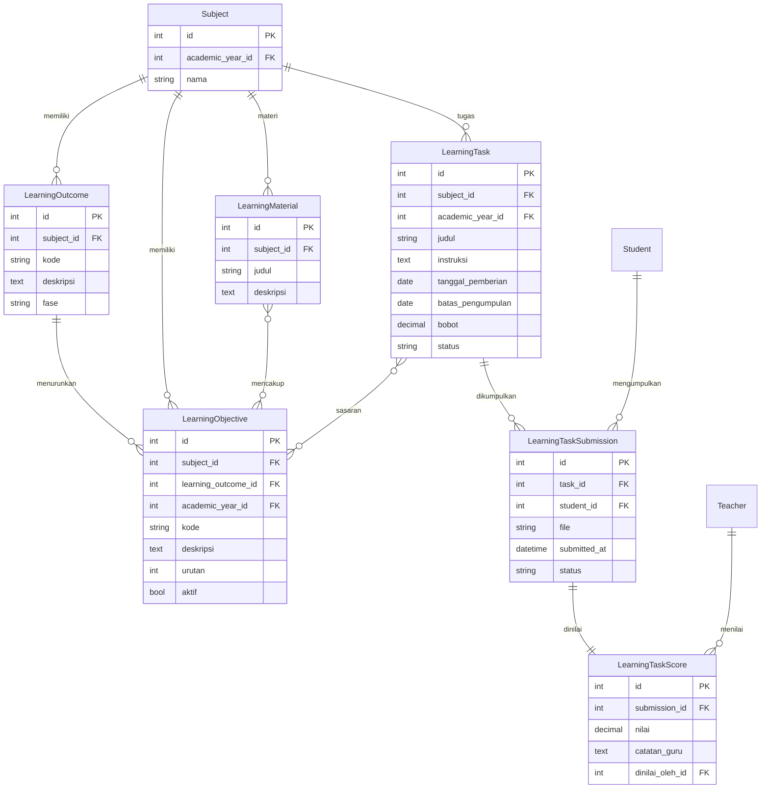
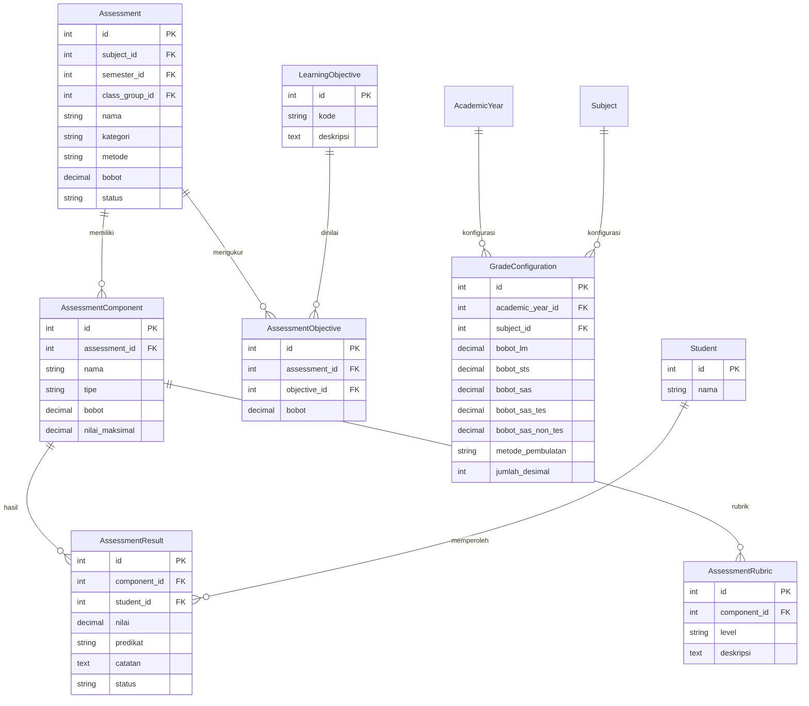
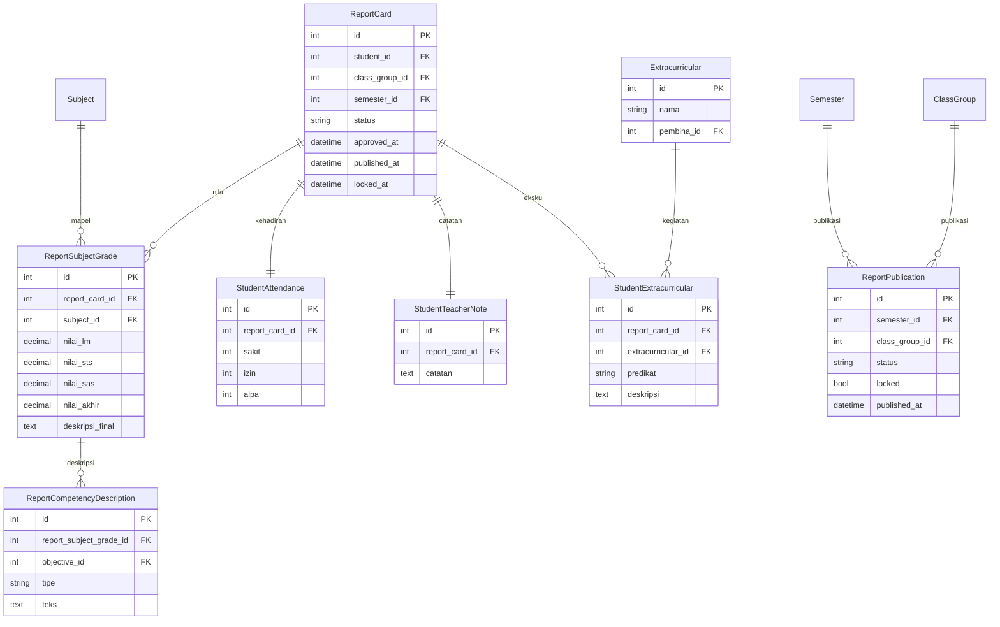

# ERD — Entity Relationship Diagram

Diagram ditulis dengan Mermaid. Nama model mengikuti rancangan target pada `database-design.md`.

## 1. Master akademik



## 2. Pembelajaran



## 3. Asesmen



## 4. Rapor dan publikasi



## 5. Alur status rapor

```text
DRAF → REVIEW (wali) → APPROVED (kepala sekolah) → PUBLISHED
  ↑         │                    │
  └─ REVISI ┘                    └─ UNLOCK (super admin, tercatat audit)
```

Semua transisi status dilakukan lewat service, bukan update langsung dari form.
